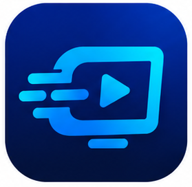

# CastSprint

<p align="center">
  
  <br>
  <strong>High-Performance, Low-Latency Mobile Screen & Audio Mirroring for Gamers & Streamers</strong>
  <br>
  <em>100% Free Forever · No Paywalls · No Ads · No Watermarks · No Cloud Required</em>
</p>

<p align="center">
  <a href="#quick-start">Quick Start</a> •
  <a href="#cross-platform-matrix">Platform Matrix</a> •
  <a href="#key-features">Key Features</a> •
  <a href="#obs-integration">OBS Integration</a> •
  <a href="#architecture">Architecture</a> •
  <a href="#documentation">Documentation</a> •
  <a href="#privacy--license">Privacy & License</a>
</p>

---

## Overview

**CastSprint** is a native, ultra-low-latency screen and game audio mirroring system engineered specifically for competitive mobile gamers, esports content creators, and livestreamers. CastSprint connects iPhone, iPad, and Android devices directly to macOS and Windows computers over high-speed USB or encrypted local Wi-Fi without any third-party cloud servers, accounts, or subscriptions.

### The CastSprint Promise
- **100% Free Forever**: Every feature—including 60 FPS locked mirroring, 1080p / Native Retina resolutions, pure internal game audio, and direct MP4 recording—is completely free. There are no "Pro" tiers, watermarks, or timed restrictions.
- **Zero Watermarks & Zero Mandatory Ads**: Your stream stays completely clean and professional.
- **100% Local & Private**: Direct USB or local Wi-Fi (LAN) connections using native operating system frameworks. Your video never leaves your private home network.

---

## Cross-Platform Matrix

| Mobile Device Source | Host Receiver | Connection Method | Mobile App Needed? | Status | Target Latency | Audio |
|:---|:---|:---:|:---:|:---:|:---:|:---:|
| **iPhone / iPad** | **Apple Mac (macOS 14+)** | **Physical USB** | **NO (Zero App)** | **Supported** | **12 – 18 ms** | Digital Uncompressed |
| **Android** | **Apple Mac (macOS 14+)** | **USB (ADB)** | Yes (CastSprint Android) | **Supported** | **25 – 35 ms** | 48kHz Internal Game Audio |
| **Android** | **Apple Mac (macOS 14+)** | **Wi-Fi (LAN)** | Yes (CastSprint Android) | **Supported** | **45 – 65 ms** | 48kHz Internal Game Audio |
| **iPhone / iPad** | **Apple Mac (macOS 14+)** | **Wi-Fi (LAN)** | Yes (CastSprint iOS) | **Supported** | **40 – 60 ms** | 48kHz AAC-LC Game Audio |
| **Android** | **Windows PC (Win 10/11)** | **Physical USB** | Yes (CastSprint Android) | **Supported** | **25 – 35 ms** | WASAPI 48kHz Game Audio |
| **Android** | **Windows PC (Win 10/11)** | **Wi-Fi (LAN)** | Yes (CastSprint Android) | **Supported** | **45 – 65 ms** | WASAPI 48kHz Game Audio |
| **iPhone / iPad** | **Windows PC (Win 10/11)** | **Wi-Fi (LAN)** | Yes (CastSprint iOS) | **Supported (Recommended)** | **40 – 60 ms** | WASAPI 48kHz Game Audio |
| **iPhone / iPad** | **Windows PC (Win 10/11)** | **AirPlay (Wi-Fi)** | **NO (Zero App)** | **Experimental** | Subject to SRP-6a crypto | WASAPI 48kHz Game Audio |
| **iPhone / iPad** | **Windows PC (Win 10/11)** | **USB Hotspot (Wired)** | Optional (App / AirPlay)| **Experimental** | Target < 35 ms | WASAPI 48kHz Game Audio |

*Note: For Windows, the CastSprint iOS companion app over Wi-Fi is the primary production route. App-less AirPlay is currently in experimental developer preview while clean-room SRP-6a / Ed25519 pairing cryptography is being standardized. See [PLATFORM_STATUS.md](docs/audit/PLATFORM_STATUS.md) for full technical details.*

---

## Key Features

- **⚡ Sub-15ms Tournament Latency on Mac**: Driverless iPhone and iPad USB screen capture utilizing macOS `CoreMediaIO.framework` and zero-copy Metal texture rendering (`CVMetalTextureCache`).
- **🔊 Pure Internal Game Audio**: Crystal-clear 48 kHz stereo audio captured directly from mobile games via `AudioPlaybackCapture` (Android) or `ReplayKit` / `CoreMediaIO` (iOS). No microphone ambient room noise.
- **⏱️ Hardware AV Synchronization**: Proprietary monotonic clock alignment and regression synchronizer ensures audio and video stay perfectly lip-synced during marathon streaming sessions.
- **📹 Direct-to-Disk MP4 Recording**: Zero-transcoding local recording on both Windows (Media Foundation Sink Writer) and macOS (`AVAssetWriter`) directly from incoming video/audio packets.
- **🎬 Native OBS Studio Optimization**: Windows Graphics Capture (WGC) on Windows and ScreenCaptureKit Window Capture on macOS for zero-overhead capture in OBS Studio.
- **🛡️ 100% Privacy & Zero Telemetry**: Contains zero tracking libraries, analytics SDKs, or remote relays.

---

## Quick Start

### 1. iPhone to Mac over USB (Zero Mobile App Needed)
1. Connect your iPhone or iPad to your Mac using a USB-C or Lightning cable.
2. Unlock your iPhone and tap **Trust** if prompted.
3. Open **CastSprint Mac** and select your iPhone in the device list.
4. Your iPhone screen and game audio immediately mirror at 60 FPS with <15ms latency!

### 2. iPhone to PC or Mac over Wi-Fi
1. Ensure both devices are on the same 5 GHz Wi-Fi network.
2. Launch CastSprint Desktop on your Windows PC or Mac. Note the 4-digit PIN.
3. Open **CastSprint iOS** on your iPhone.
4. Select your computer from the Discovered list (or scan the pairing QR code).
5. Tap **Launch Broadcast Picker** -> Select **CastSprint** -> Tap **Start Broadcast**.

### 3. Android to PC or Mac over USB
1. Enable **Developer Options** & **USB Debugging** on your Android device.
2. Connect phone via USB cable and allow USB debugging.
3. Launch CastSprint Desktop and open **CastSprint Android**.
4. Select **USB Mode** and tap **Start Mirroring**.

---

## OBS Studio Integration

```
[Mobile Device (Game + Audio)]
             |
             +---> USB / Wi-Fi (CastSprint Protocol)
             |
             v
[CastSprint Desktop Receiver (Windows / macOS)]
             |
             +---> Window Capture (ScreenCaptureKit / WGC)
             +---> Application Audio Capture (Isolated Game Sound)
             |
             v
[OBS Studio: Clean Tournament Feed]
```

1. In OBS Studio, add a **Window Capture** source:
   * **macOS:** Choose `macOS Screen Capture` -> `Window Capture` -> select `[CastSprint]: CastSprint — Gaming View`.
   * **Windows:** Choose `Window Capture` -> select `[castsprint_receiver.exe]: CastSprint — Gaming View` with `Windows Graphics Capture (WGC)`.
2. Add an **Application Audio Capture** source in OBS to isolate game sound without capturing Discord or desktop alerts.
3. *Read the complete guide in [OBS Studio Streaming Guide](docs/apple/OBS_GUIDE.md).*

---

## Documentation

* **Full Project Audit:** [docs/audit/FULL_PROJECT_AUDIT.md](docs/audit/FULL_PROJECT_AUDIT.md)
* **Feature & Capability Matrix:** [docs/audit/FEATURE_MATRIX.md](docs/audit/FEATURE_MATRIX.md)
* **Final Master Platform Matrix:** [docs/FINAL_PLATFORM_MATRIX.md](docs/FINAL_PLATFORM_MATRIX.md)
* **End-to-End Real Device Results:** [docs/END_TO_END_RESULTS.md](docs/END_TO_END_RESULTS.md)
* **Release Readiness & Packaging:** [docs/RELEASE_READINESS.md](docs/RELEASE_READINESS.md)
* **Windows AirPlay Feasibility & Legal Analysis:** [docs/research/WINDOWS_AIRPLAY_FEASIBILITY.md](docs/research/WINDOWS_AIRPLAY_FEASIBILITY.md)
* **Windows iPhone OBS Streaming Guide:** [docs/windows/OBS_IPHONE_GUIDE.md](docs/windows/OBS_IPHONE_GUIDE.md)
* **macOS Installation & Notarization:** [docs/apple/MAC_INSTALLATION.md](docs/apple/MAC_INSTALLATION.md)
* **iOS App Store & TestFlight:** [docs/apple/APP_STORE_SUBMISSION.md](docs/apple/APP_STORE_SUBMISSION.md)
* **Performance Benchmarks & Test Matrix:** [docs/testing/PERFORMANCE_RESULTS.md](docs/testing/PERFORMANCE_RESULTS.md)
* **OBS Studio Master Guide:** [docs/apple/OBS_GUIDE.md](docs/apple/OBS_GUIDE.md)
* **Apple Permissions & Security:** [docs/apple/APPLE_PERMISSIONS.md](docs/apple/APPLE_PERMISSIONS.md)
* **Platform Compatibility Matrix:** [docs/apple/COMPATIBILITY.md](docs/apple/COMPATIBILITY.md)
* **Protocol v1 Specification:** [docs/architecture/PROTOCOL.md](docs/architecture/PROTOCOL.md)
* **Windows iPhone USB Feasibility Study:** [docs/research/IPHONE_WINDOWS_USB.md](docs/research/IPHONE_WINDOWS_USB.md)
* **Third-Party Notices:** [THIRD_PARTY_NOTICES.md](THIRD_PARTY_NOTICES.md)

---

## Privacy & License

CastSprint is open-source software licensed under the **[Apache License, Version 2.0](LICENSE)**.

- **Zero Data Collection**: No telemetry, analytics, or user accounts.
- **Zero Cloud Video**: Direct peer-to-peer transmission over USB and local network only.
- **Copyright**: © 2026 The CastSprint Project Authors.
