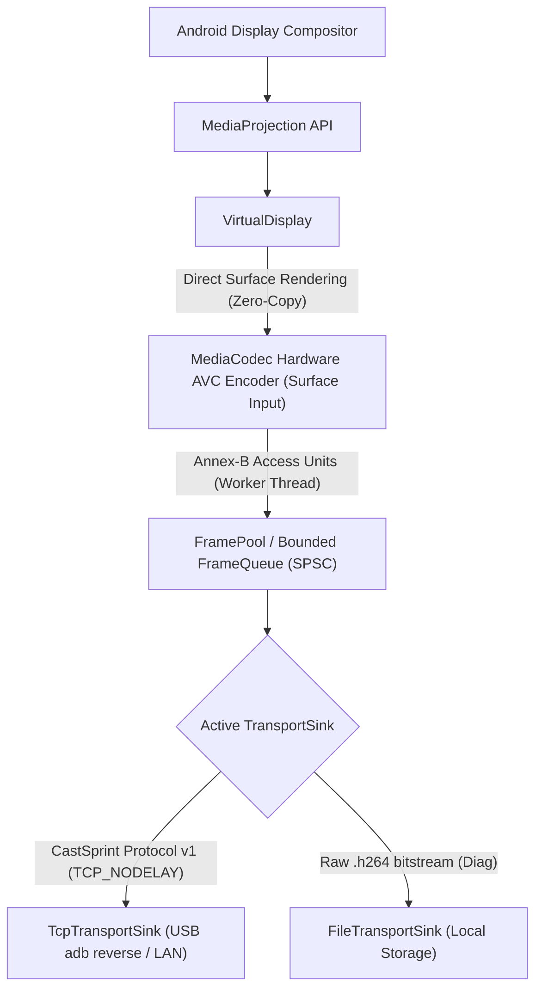
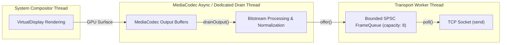

# Android Screen Capture & Hardware Encoding Architecture

This document describes the native Android screen capture and hardware H.264 encoding engine in CastSprint (`apps/android`).

---

## 1. Pipeline Overview

CastSprint uses a pure zero-copy hardware pipeline from the display compositor to the hardware encoder:

Key performance properties:
- **Zero-Copy Capture**: Screen pixels are drawn directly from the system compositor into the `MediaCodec` input surface created via `createInputSurface()`. No CPU pixel copying (`ImageReader` / `byte[]`) occurs.
- **Low-Latency Configuration**: Encoder configured with `KEY_LATENCY = 0` (where supported), `KEY_PRIORITY = 0` (real-time priority), and CBR bitrate mode (`BITRATE_MODE_CBR`).
- **Bounded Buffer Memory**: A dedicated memory pool (`FramePool`) recycles byte buffers up to 1 MB each. The bounded queue (`FrameQueue`) drops delta frames under backpressure to minimize transmission latency while preserving IDR keyframes.

---

## 2. MediaProjection & Foreground Service (Android 10+ / 14+)

Android 10 (`targetSdk 29`) introduced mandatory foreground service types, and Android 14 (`targetSdk 34+`, including Android 15/16) enforces strict start-ordering rules:

1. **Permission Flow**:
   - `MainActivity` launches `MediaProjectionManager.createScreenCaptureIntent()` via `startActivityForResult`.
   - The user selects whether to share a single app or the entire display.
2. **Foreground Service Requirement**:
   - In Android 14+, calling `MediaProjectionManager.getMediaProjection(resultCode, data)` requires an active foreground service with `foregroundServiceType="mediaProjection"`.
   - `ScreenCaptureService` calls `startForeground(NOTIFICATION_ID, notification, FOREGROUND_SERVICE_TYPE_MEDIA_PROJECTION)` **before** obtaining the `MediaProjection` token.
3. **Notification Lifecycle**:
   - Uses a dedicated notification channel (`castsprint_capture`, `IMPORTANCE_LOW`).
   - Notification is ongoing and provides a direct "Stop Mirroring" action button.
   - Cleans up and calls `stopForeground(STOP_FOREGROUND_REMOVE)` on session termination.
4. **Thermal Throttling**:
   - Registers `PowerManager.OnThermalStatusChangedListener` (Android 10+).
   - Dynamically drops encoder bitrate during severe thermal throttling (`THERMAL_STATUS_SEVERE`, `THERMAL_STATUS_CRITICAL`) and requests keyframes upon recovery.

---

## 3. Dynamic Encoder Capability Query & Fallback Selection

Mobile devices have diverse hardware encoder constraints. `MediaCodecCapabilitiesQuery` inspects `MediaCodecList` at runtime for `video/avc` encoders supporting `FEATURE_InputSurface`:

- Hardware encoders (`c2.*.hardware`, `OMX.qcom.*`, `OMX.Exynos.*`) are prioritized over software fallbacks (`c2.android.avc.encoder`, `OMX.google.*`).
- Target resolution is dynamically adapted via `EncoderConfigSelector`:
  - **Aspect Ratio Preservation**: Displays of any ratio (16:9, 19.5:9, 20:9, etc.) are scaled to fit within the bounding box (e.g. 1080p: `1920x1080`).
  - **Macroblock Multiple-of-16 Alignment**: Dimensions are rounded down to multiples of 16 (e.g. 1080x2400 becomes `864x1920`) to comply with H.264 macroblock constraints across all SoC encoders.
  - **Capability Fallback**: If the hardware encoder cannot sustain 1080p60, the selector gracefully steps down to 1080p30, then 720p60, then 720p30.

---

## 4. Bitstream Normalization & Format Conversion

Hardware encoders emit H.264 bitstreams with minor vendor variations. `H264.kt` provides bitstream normalization:

- **Annex-B Framing**: Ensures 4-byte start codes (`00 00 00 01`) for stream synchronization.
- **CSD Extraction**: Inspects codec configuration buffers to parse Sequence Parameter Sets (SPS) and Picture Parameter Sets (PPS), extracting H.264 profile and level.
- **NAL Unit Identification**: Accurately detects IDR keyframes (`nal_unit_type = 5`) versus non-IDR slices (`nal_unit_type = 1`), SEI, SPS, and PPS.
- **AVCC Support**: Utility for receiver or container formats requiring length-prefixed AVCC format.

---

## 5. Threading & Concurrency Model

- **Capture & Render**: Executed asynchronously on the GPU by the system compositor directly onto the encoder's input Surface.
- **Encoder Drain Thread**: A dedicated high-priority worker thread drains output buffers from `MediaCodec.dequeueOutputBuffer` with minimal polling timeout (10 ms).
- **Transport Worker Thread**: Sinks (`TcpTransportSink` or `FileTransportSink`) consume frames from the bounded `FrameQueue`.
- **Backpressure Policy**:
  - If the transport queue reaches capacity (default: 8 frames), the queue drops non-keyframe buffers to prevent latency accumulation.
  - When a frame is dropped, the `FRAME_DISCONTINUITY` flag is set on the next transmitted frame, and an on-demand IDR sync frame is requested from the encoder via `PARAMETER_KEY_REQUEST_SYNC_FRAME`.

---

## 6. Sinks & Diagnostic Modes

CastSprint provides two swappable `TransportSink` implementations:

1. **`TcpTransportSink` (USB / PC Streaming)**:
   - Connects to `127.0.0.1:51820` (forwarded via `adb reverse tcp:51820 tcp:51820`) or a remote LAN IP.
   - Implements CastSprint Protocol v1:
     - `HELLO` handshake and protocol version negotiation.
     - `VIDEO_CONFIG` packet containing SPS/PPS extradata.
     - `VIDEO_FRAME` packets containing PTS, flags (Keyframe, Discontinuity), and Annex-B payload.
     - Periodic `HEARTBEAT` messages for connection liveness.
2. **`FileTransportSink` (Standalone Diagnostic Mode)**:
   - Records raw Annex-B `.h264` stream directly to application storage (`context.getExternalFilesDir(null)`).
   - Requires zero PC receiver software, allowing standalone validation of encoding quality, framerate, and NAL structure using standard tools (`ffprobe`, `ffplay`, VLC).
