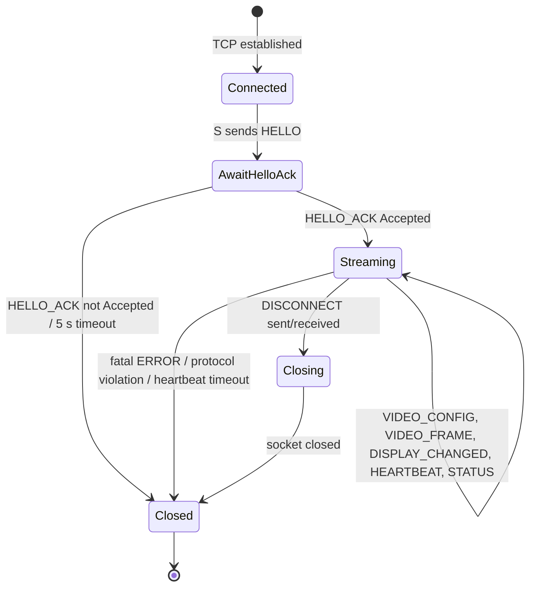

# CastSprint Protocol v1

Status: **Normative** for protocol version `1`. Reference implementations:
[`native/protocol`](../../native/protocol) (C++20, full codec) and
[`ProtocolV1.kt`](../../apps/android/app/src/main/java/com/castsprint/android/protocol/ProtocolV1.kt)
(Kotlin, sender subset). Both are checked against shared golden vectors.

CastSprint Protocol is an original design. It is not derived from scrcpy or any other project.

## 1. Transport

- Reliable, ordered byte stream: **TCP** (v1). Over USB the sender reaches the receiver through
  `adb reverse tcp:27183 tcp:27183`; over LAN it connects directly to the receiver's IP.
- Roles: **Receiver** (Windows) listens. **Sender** (Android) connects.
- Default port: **27183**.
- One session per TCP connection. Messages are framed back-to-back with no padding.
- `TCP_NODELAY` MUST be enabled on both ends.

## 2. Conventions

- All integers are unsigned and **big-endian** (network byte order) unless stated.
- `u8/u16/u32/u64` = 1/2/4/8 bytes. `str` = `u16 length` + `length` bytes UTF-8, no terminator,
  `length ≤ 256`.
- Fields named `reserved` MUST be sent as 0 and MUST be rejected if non-zero (v1 strictness lets
  future versions repurpose them behind a version bump).
- Timestamps are microseconds (`u64`). Video PTS uses the sender's monotonic clock
  (`MediaCodec.BufferInfo.presentationTimeUs`).

## 3. Header (24 bytes, every message)

| Offset | Size | Field           | Rules |
|-------:|-----:|-----------------|-------|
| 0      | 4    | `magic`         | `0x43535052` ("CSPR"). Else → `BadMagic`, close. |
| 4      | 1    | `version`       | Must be `1`. Else → `UnsupportedVersion`. |
| 5      | 1    | `type`          | See §4. Unknown → `UnknownType`. |
| 6      | 2    | `flags`         | Reserved in v1, must be 0. |
| 8      | 4    | `session_id`    | 0 in `HELLO`; assigned value in all later messages. |
| 12     | 4    | `sequence`      | Per-direction counter, starts at 0, +1 per message, wraps at 2³². |
| 16     | 4    | `payload_length`| Bytes following the header. See limits. |
| 20     | 4    | `reserved`      | Must be 0. |

**Payload limits:** `VIDEO_FRAME`, `AUDIO_FRAME`: ≤ 8 MiB (8 388 608). All other types:
≤ 64 KiB (65 536). Exceeding → `PayloadTooLarge`, connection closed *before* reading the payload,
so a hostile peer cannot force large allocations. Max message size = 24 + 8 MiB.

## 4. Message types

| Code | Name             | Direction | Payload size |
|-----:|------------------|-----------|--------------|
| 0x01 | `HELLO`          | S → R     | 20 + strings |
| 0x02 | `HELLO_ACK`      | R → S     | 12 |
| 0x10 | `VIDEO_CONFIG`   | S → R     | 24 + csd |
| 0x11 | `VIDEO_FRAME`    | S → R     | 16 + data |
| 0x20 | `AUDIO_CONFIG`   | S → R     | 12 + csd (reserved for Phase 4) |
| 0x21 | `AUDIO_FRAME`    | S → R     | 8 + data (reserved for Phase 4) |
| 0x30 | `DISPLAY_CHANGED`| S → R     | 12 |
| 0x40 | `HEARTBEAT`      | both      | 16 |
| 0x41 | `STATUS`         | both      | 4 + string |
| 0x50 | `DISCONNECT`     | both      | 4 + string |
| 0x51 | `ERROR`          | both      | 4 + string |

### 4.1 HELLO (0x01)
| Off | Size | Field | Rules |
|---:|---:|---|---|
| 0 | 1 | `min_version` | ≥ 1 |
| 1 | 1 | `max_version` | ≥ `min_version` |
| 2 | 2 | reserved | 0 |
| 4 | 4 | `capabilities` | bit0 H.264, bit1 audio, bit2 H.265; others 0 |
| 8 | 2 | `android_api_level` | |
| 10 | 2 | `screen_width` | physical px |
| 12 | 2 | `screen_height` | physical px |
| 14 | 2 | `density_dpi` | |
| 16 | str | `device_name` | ≤ 256 B |
| … | str | `device_model` | ≤ 256 B |

### 4.2 HELLO_ACK (0x02)
| Off | Size | Field | Rules |
|---:|---:|---|---|
| 0 | 1 | `status` | 0 Accepted, 1 VersionUnsupported, 2 Busy, 3 Rejected |
| 1 | 1 | `accepted_version` | within sender range |
| 2 | 2 | reserved | 0 |
| 4 | 4 | `session_id` | non-zero random when Accepted |
| 8 | 4 | `max_payload_size` | ≤ 8 MiB; sender must respect |

### 4.3 VIDEO_CONFIG (0x10)
| Off | Size | Field | Rules |
|---:|---:|---|---|
| 0 | 4 | `config_id` | increments on every encoder (re)configuration |
| 4 | 1 | `codec` | 1 H.264, 2 H.265 |
| 5 | 1 | `profile` | H.264 `profile_idc` (66/77/100) |
| 6 | 1 | `level` | H.264 `level_idc` |
| 7 | 1 | `rotation` | 0..3 (×90° clockwise) |
| 8 | 2 | `width` | coded width, > 0 |
| 10 | 2 | `height` | coded height, > 0 |
| 12 | 2 | `frame_rate` | target fps |
| 14 | 2 | reserved | 0 |
| 16 | 4 | `bitrate` | bps |
| 20 | 4 | `csd_length` | ≤ 16 KiB |
| 24 | n | `csd` | Annex-B SPS+PPS (`MediaCodec` `BUFFER_FLAG_CODEC_CONFIG` output) |

### 4.4 VIDEO_FRAME (0x11)
| Off | Size | Field | Rules |
|---:|---:|---|---|
| 0 | 4 | `config_id` | must match latest `VIDEO_CONFIG`; else frame dropped |
| 4 | 4 | `frame_flags` | bit0 keyframe, bit1 discontinuity, bit2 end-of-stream; others 0 |
| 8 | 8 | `pts_us` | presentation timestamp |
| 16 | n | `data` | exactly one Annex-B access unit; n ≥ 1 unless end-of-stream |

### 4.5 AUDIO_CONFIG (0x20) / AUDIO_FRAME (0x21)
CONFIG: `codec u8` (1 Opus, 2 AAC, 3 PCM s16le), `channels u8` (1..8), reserved u16,
`sample_rate u32` (>0), `csd_length u32` (≤16 KiB), `csd`.
FRAME: `pts_us u64`, `data` (≥1 byte). Defined now; implemented in Phase 4.

### 4.6 DISPLAY_CHANGED (0x30)
`width u16`, `height u16` (>0), `rotation u8` (0..3), reserved u8, reserved u16,
`next_config_id u32`. Announces that frames for the old config end; a `VIDEO_CONFIG` with
`next_config_id` and a keyframe follow.

### 4.7 HEARTBEAT (0x40)
`timestamp_us u64` (sender's clock), `echo_timestamp_us u64` (last peer timestamp received, 0 if
none). Allows RTT measurement: `rtt = now − echo`.

### 4.8 STATUS (0x41) / DISCONNECT (0x50) / ERROR (0x51)
- STATUS: `code u16`, `message str`. Informational (e.g. 1 = encoder ready).
- DISCONNECT: `reason u16` (1 UserRequested, 2 Shutdown, 3 Timeout, 4 ProtocolError,
  5 CaptureStopped), `message str`. Sender of DISCONNECT closes after flushing.
- ERROR: `code u16`, `fatal u8` (0/1), reserved u8, `message str`. Fatal → close.

## 5. Validation (receiver MUST)

1. Read exactly 24 bytes; validate magic, version, type, flags, reserved, payload limit.
2. Only then read `payload_length` bytes into a bounded buffer.
3. Decode payload; any short read → `Truncated`, unread bytes left → `TrailingBytes`,
   out-of-range enum/size → `InvalidField`, string > 256 → `StringTooLong`.
4. Any header or payload error ⇒ send `ERROR(fatal=1)` if possible and close. No resync attempts.

## 6. Connection state machine



Rules:
- Receiver accepts only `HELLO` in `Connected`; must reply within 5 s.
- First media after `HELLO_ACK` must be `VIDEO_CONFIG`, then a `VIDEO_FRAME` with keyframe flag.
  Receiver drops non-key frames until it has a keyframe for the current `config_id`.
- `session_id` in every post-handshake header must equal the assigned value.
- Heartbeat interval 1 s each direction; peer considered dead after 5 s without any message.

## 7. Versioning

- Breaking changes increment `version`. `HELLO` advertises `[min,max]`; receiver picks the highest
  common version or answers `VersionUnsupported`. The header layout (magic + version at fixed
  offsets) is frozen across all versions so any peer can reject cleanly.

## 8. Golden vector

HEARTBEAT, session 1, sequence 2, ts `0x0102030405060708`, echo `0x1112131415161718`:
```
43 53 50 52 01 40 00 00 00 00 00 01 00 00 00 02 00 00 00 10 00 00 00 00
01 02 03 04 05 06 07 08 11 12 13 14 15 16 17 18
```
