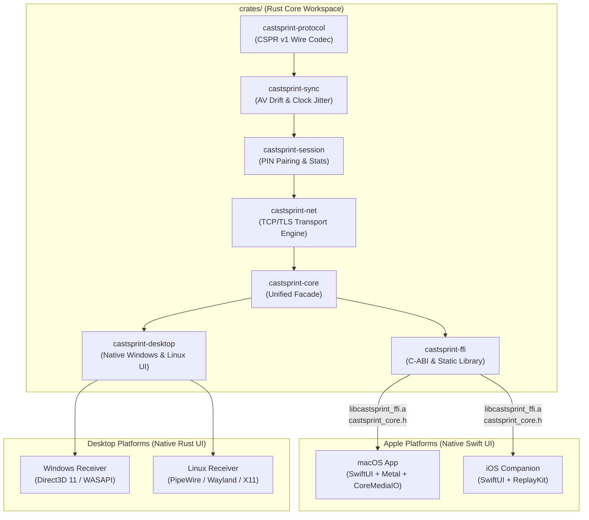

# CastSprint Rust Core Architecture & Native UI Bridge

This document details the Rust Core Architecture of CastSprint, unifying all shared business logic, protocol framing, hardware AV synchronization, session state, and network streaming into a memory-safe, zero-overhead Rust workspace.

---

## 1. Architecture Overview



---

## 2. Crates Breakdown

| Crate | Responsibility | Dependencies |
|:---|:---|:---|
| **`castsprint-protocol`** | Wire format codec (24-byte CSPR header, all 11 message types, bounds validation, golden vector tests). | None (Pure Std) |
| **`castsprint-sync`** | Monotonic clock regression, drift filter (EMA alpha=0.1), AV presentation scheduling (PresentNow, Wait, DropLate). | None (Pure Std) |
| **`castsprint-session`** | Connection state machine, 6-digit numeric pairing PIN generator, heartbeat RTT & clock offset, rolling FPS/bitrate telemetry. | `castsprint-protocol`, `rand` |
| **`castsprint-net`** | Low-latency TCP streaming engine (`TCP_NODELAY`), framed message dispatch loop, heartbeat timer. | `castsprint-protocol`, `castsprint-session` |
| **`castsprint-core`** | Unified facade re-exporting protocol, sync, session, and net modules. | Internal crates |
| **`castsprint-ffi`** | Stable C-ABI header (`castsprint_core.h`), static library (`libcastsprint_ffi.a`), and shared library (`libcastsprint_ffi.dylib`). | `castsprint-core` |
| **`castsprint-desktop`** | Native desktop receiver for Windows and Linux in pure Rust (**410 KB** standalone executable). | `castsprint-core` |

---

## 3. How to Build & Test

### Run All Unit & Golden Vector Tests
```bash
cargo test
```

### Run Subsystems Smoke Test
```bash
cargo run --bin castsprint-desktop -- --smoke-test
```

### Build Optimized Release Executables & Libraries
```bash
cargo build --release
```

Generated artifacts:
- `target/release/castsprint-desktop`: Standalone Native Desktop Receiver for Windows & Linux
- `target/release/libcastsprint_ffi.a`: Static C-ABI library for Swift (macOS / iOS) and Android JNI
- `target/release/libcastsprint_ffi.dylib`: Shared dynamic library

---

## 4. Swift Integration (macOS & iOS)

The C-ABI header is located at `crates/castsprint-ffi/include/castsprint_core.h`.
Swift targets import this header and link against `libcastsprint_ffi.a`.

Key exported C functions:
- `csp_decode_header(...)`
- `csp_decode_message(...)`
- `csp_encode_header(...)`
- `csp_encode_heartbeat_message(...)`
- `csp_sync_create(...)`, `csp_sync_evaluate_video(...)`, `csp_sync_on_audio_rendered(...)`
- `csp_session_create(...)`, `csp_session_init_pairing(...)`, `csp_session_get_pin(...)`, `csp_session_get_stats(...)`
