# Streaming Pipeline

```mermaid
flowchart LR
    A[Android screen] --> B[MediaProjection]
    B --> C[VirtualDisplay]
    C -->|Surface| D["MediaCodec H.264 encoder"]
    D -->|Annex-B AUs| E["CastSprint transport (TCP)"]
    E -->|USB adb reverse / LAN| F[Windows receiver]
    F --> G["Media Foundation H.264 decoder (DXVA)"]
    G -->|NV12 ID3D11Texture2D| H["Direct3D 11 renderer"]
    H --> I[Native desktop window / OBS capture]
```

## Stage details

1. **MediaProjection** — user consents via `MediaProjectionManager.createScreenCaptureIntent()`;
   runs inside a foreground service of type `mediaProjection` (required on Android 10+/14+).
2. **VirtualDisplay** — renders directly into the encoder's input `Surface` (zero-copy).
   Size = device resolution scaled to a user cap (e.g. 1080p), dimensions rounded to multiples of 16.
3. **MediaCodec H.264** — `KEY_LATENCY=0` / low-latency where supported, `KEY_PRIORITY=0`,
   CBR/VBR configurable, `KEY_I_FRAME_INTERVAL` 2–5 s, `KEY_REPEAT_PREVIOUS_FRAME_AFTER` so static
   scenes still produce frames. `PARAMETER_KEY_REQUEST_SYNC_FRAME` on receiver request.
   Codec-config buffer → `VIDEO_CONFIG`; every output buffer → one `VIDEO_FRAME`.
4. **Transport** — TCP_NODELAY; writer thread drains a bounded queue (see THREADING.md). If the
   queue is full, non-key frames are dropped and a keyframe is requested (latency over completeness).
5. **Receiver** — reads header (24 B), validates, reads payload into a pooled buffer.
6. **Decode** — H.264 decoder MFT with `MF_LOW_LATENCY`, D3D11 device manager
   (`IMFDXGIDeviceManager`) so output stays on the GPU.
7. **Render** — NV12 → RGB via shader (or video processor), letterboxed into a flip-model swap chain;
   present on vsync or immediately (tearing allowed) for minimum latency.
8. **Window** — Win32 window; OBS captures it via Window/Game capture. No overlays or watermark.

## Latency budget (targets, to be measured — not claims)

| Stage | Target |
|---|---|
| Capture + encode | ≤ 16 ms |
| Transport (USB) | ≤ 3 ms |
| Decode | ≤ 8 ms |
| Render + present | ≤ 1 frame |

## Phase 1 status
Implemented: protocol codec, Win32 + D3D11 shell, Android app shell. Everything else above is design.
