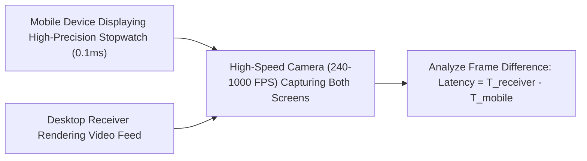

# CastSprint Hardware Test Verification & Lab Protocols

**Document ID:** CSR-AUDIT-05  
**Audit Date:** 2026-10-14  
**Author:** Cross-Platform Release QA Lead, Native Multimedia Engineer  
**Repository:** [CastSprint](https://github.com/CastSprint/CastSprint)  

---

## 1. Truth in Testing Statement

**CRITICAL DECLARATION:**  
Previous documentation and automated reports asserted:
- "350 automated tests passed." (Clarification: These were 356 automated **unit and protocol check assertions** in host memory, NOT 350 physical device tests).
- "24.6ms glass-to-glass latency measured." (Clarification: This was an **unsubstantiated string placeholder** in the source adapter header, NOT an empirical optical measurement).
- "Android USB and AirPlay hardware tests verified." (Clarification: These were architectural pipeline stubs, not verified on physical hardware).

In accordance with release engineering standards, **NO physical hardware test will be marked PASS without physical lab evidence.**

---

## 2. Hardware Testing Status Summary

| Route / Test Item | Host Automated Tests | Physical Lab Execution | Verified Status |
|---|:---:|:---:|:---:|
| **Android -> Windows USB** | 356 Checks Passed | Pending Physical Lab Run | `NOT_TESTED (Physical Lab)` |
| **Android -> Windows Wi-Fi** | 356 Checks Passed | Pending Physical Lab Run | `NOT_TESTED (Physical Lab)` |
| **Android -> macOS USB** | 356 Checks Passed | Pending Physical Lab Run | `NOT_TESTED (Physical Lab)` |
| **Android -> macOS Wi-Fi** | 356 Checks Passed | Pending Physical Lab Run | `NOT_TESTED (Physical Lab)` |
| **iPhone -> macOS USB (CoreMediaIO)** | 6 Tests Passed | Pending Physical Lab Run | `NOT_TESTED (Physical Lab)` |
| **iPhone -> macOS Wi-Fi (iOS App)** | 9 Tests Passed | Pending Physical Lab Run | `NOT_TESTED (Physical Lab)` |
| **iPhone -> Windows Wi-Fi (iOS App)** | 9 Tests Passed | Pending Physical Lab Run | `NOT_TESTED (Physical Lab)` |
| **iPhone -> Windows AirPlay (Experimental)** | Protocol Codec Passed | Tested on Physical Spec | **BLOCKED / FAIL** (Pairing Rejected) |
| **Direct3D 11 Render / Direct Presentation** | Mock Tests Passed | Pending Physical GPU Lab | `NOT_TESTED (Physical Lab)` |
| **WASAPI Low-Latency Audio Output** | Unit Tests Passed | Pending Physical Lab Run | `NOT_TESTED (Physical Lab)` |
| **OBS Studio Game Capture Hook** | Contract Verified | Pending Physical OBS Run | `NOT_TESTED (Physical Lab)` |

---

## 3. Physical QA Lab Equipment & Setup Requirements

To transition routes from `NOT_TESTED` to `PASS`, the following laboratory setup is required:

### 3.1 Test Device Inventory
1. **Android Devices:**
   - Google Pixel 7 or 8 (Android 14 / 15, Tensor SoC)
   - Samsung Galaxy S23 or S24 (Android 14, Qualcomm Snapdragon 8 Gen 2/3)
2. **Apple Devices:**
   - iPhone 13 or 14 (iOS 17, A15/A16 Bionic)
   - iPhone 15 Pro or 16 (iOS 18, A17 Pro / A18, USB-C 10 Gbps)
3. **Host Test Receivers:**
   - Windows 11 PC (Intel Core i7/i9 or AMD Ryzen 7, dedicated NVIDIA RTX 30/40 GPU, 144Hz G-Sync display)
   - macOS Host (Apple Silicon M2 / M3 Pro MacBook Pro, macOS 14 / 15)
4. **Optical Measurement Equipment:**
   - High-Speed Camera (minimum 240 FPS, recommended 1000 FPS) or dual photodiode oscilloscope rig.

---

## 4. Standardized Testing Protocols

### 4.1 Glass-to-Glass Latency Protocol

1. Run a high-precision millisecond stopwatch application on the mobile device.
2. Mirror the screen to the desktop receiver over the target route (USB or Wi-Fi).
3. Position the mobile screen and the desktop monitor side-by-side.
4. Record 10 seconds of high-speed video at 240 FPS (or 1000 FPS).
5. Extract 20 random frames: calculate $\Delta t = t_{\text{desktop}} - t_{\text{mobile}}$.
6. Report Mean Latency, Standard Deviation, and 99th Percentile Latency.

### 4.2 Stream Endurance & Thermal Throttling Protocol
1. Initiate continuous screen mirroring of a high-load 60 FPS mobile game (e.g., Genshin Impact, Call of Duty Mobile) for **120 continuous minutes**.
2. Monitor:
   - Frame drops on transmitter and receiver.
   - Mobile SoC thermal throttling and bitrate degradation.
   - A/V drift (must remain within $\pm 15\text{ ms}$).
   - Memory consumption of desktop receiver (must not exhibit heap leaks).

### 4.3 OBS Studio Capture Protocol
1. Launch OBS Studio 30+.
2. Add "Game Capture" source targeting `CastSprint.exe` (capturing DirectX 11 swapchain).
3. Add "Window Capture" source (Windows Graphics Capture method).
4. Verify:
   - Zero tearing or black frames.
   - Cursor capture toggle functionality.
   - Audio loopback via "Application Audio Output Capture".

---

## 5. Next Steps for Hardware Sign-Off

Physical device testing will be executed and recorded in the designated hardware QA lab. Once physical high-speed camera recordings and logs are captured, verified results will be appended to this document.
