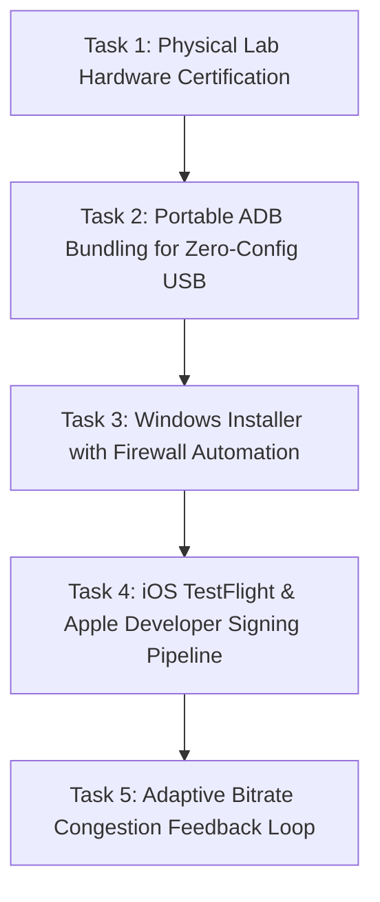

# CastSprint Next Implementation Tasks

**Document ID:** CSR-AUDIT-07  
**Audit Date:** 2026-10-14  
**Author:** Principal Software Architect, Cross-Platform Release QA Lead  
**Repository:** [CastSprint](https://github.com/CastSprint/CastSprint)  

---

## 1. Overview & Execution Roadmap

This document outlines the top five concrete implementation tasks required to deliver a rock-solid, production-ready CastSprint Public Beta.



---

## 2. Top Five Tasks in Priority Order

### Task 1: Physical Hardware Certification & High-Speed Camera Latency Measurement
- **Priority:** **P0 (Immediate)**
- **Objective:** Obtain verified, empirical physical proof of glass-to-glass latency, frame stability, and OBS integration across physical Android and iOS devices connected to physical Windows and macOS hosts.
- **Action Items:**
  1. Set up high-speed camera (240 FPS / 1000 FPS) directed at mobile screen and desktop receiver monitor.
  2. Execute 10-minute gaming runs over:
     - Android USB (ADB reverse) -> Windows 11 PC (NVIDIA GPU).
     - Android Wi-Fi -> Windows 11 PC.
     - iPhone USB (CoreMediaIO) -> Apple Silicon Mac.
     - iPhone Wi-Fi (CastSprint iOS app) -> Windows 11 PC.
  3. Measure and calculate exact millisecond delta between touch/timer and desktop display.
  4. Record output in `docs/audit/HARDWARE_TEST_RESULTS.md` with photos and video artifact links.

### Task 2: Portable ADB Bundling for Zero-Config Android USB Mirroring
- **Priority:** **P1**
- **Objective:** Eliminate the requirement for users to manually install the Android SDK or platform-tools.
- **Action Items:**
  1. Add a build script (`scripts/bundle_adb.py` or CMake target) that downloads the official Google Android Platform Tools archive (`platform-tools-latest-windows.zip` / `darwin.zip`).
  2. Bundle minimal `adb.exe`, `AdbWinApi.dll`, and `AdbWinUsbApi.dll` into the application installation directory (`tools/adb/`).
  3. Update `apps/windows/src/adb_tunnel.hpp` to prioritize the relative application subfolder `./tools/adb/adb.exe` before searching system PATH.

### Task 3: Windows Installer (Inno Setup / WiX) & Firewall Exception Automation
- **Priority:** **P1**
- **Objective:** Provide a professional single-click installer that registers Windows Defender Firewall rules and eliminates network connection failures.
- **Action Items:**
  1. Create `installer/windows/CastSprintSetup.iss` using Inno Setup.
  2. Embed automated firewall rule registration during installation:
     ```cmd
     netsh advfirewall firewall add rule name="CastSprint Receiver" dir=in action=allow program="{app}\CastSprint.exe" enable=yes
     ```
  3. Package Microsoft Visual C++ Redistributable check.
  4. Generate release artifact in CI via GitHub Actions.

### Task 4: Apple Developer Signing & iOS TestFlight Pipeline
- **Priority:** **P1**
- **Objective:** Distribute the CastSprint iOS Companion Application to beta testers via Apple TestFlight.
- **Action Items:**
  1. Configure Apple Developer Team ID and App ID for `com.castsprint.ios` and `com.castsprint.ios.broadcast`.
  2. Configure App Group `group.com.castsprint.ios` in Apple Developer Portal.
  3. Set up GitHub Actions fastlane or `xcodebuild` step to archive and upload the IPA to App Store Connect / TestFlight.

### Task 5: Dynamic Bitrate & Congestion Control Feedback Loop
- **Priority:** **P2**
- **Objective:** Automatically adapt video bitrate to wireless network congestion to prevent frame dropping.
- **Action Items:**
  1. Implement periodic receiver telemetry message (`PACKET_TYPE_RECEIVER_STATS`) sent upstream from receiver to transmitter every 1000ms.
  2. Include round-trip time (RTT), receiver buffer occupancy, and packet loss percentage.
  3. Update `VideoEncoder.kt` (Android) and `VideoToolboxEncoder.swift` (iOS) to dynamically adjust bitrate via `MediaCodec.setParameters(bundle)` and `VTSessionSetProperty(kVTCompressionPropertyKey_AverageBitRate)`.

---

## 3. Implementation Verification Criteria

| Task | Completion Metric |
|---|---|
| **Task 1** | Optical camera frame-by-frame measurement logged in `HARDWARE_TEST_RESULTS.md`. |
| **Task 2** | Android USB connects immediately on a clean Windows machine without Android Studio installed. |
| **Task 3** | Inbound network connections succeed on Windows without firewall dialog warnings. |
| **Task 4** | CastSprint iOS app installed and tested on a physical un-jailbroken iPhone via TestFlight. |
| **Task 5** | Bitrate steps down seamlessly during artificial packet loss injection without dropping the session. |
