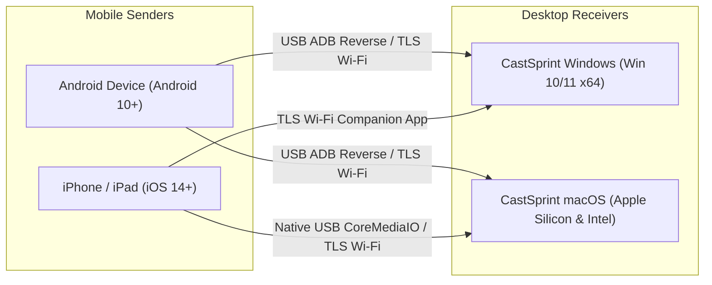

# CastSprint Platform Compatibility & Feature Matrix

**Document ID:** CSR-PLATFORM-MATRIX-01  
**Audit Date:** 2026-10-14  
**Author:** Cross-Platform Release QA Lead, Principal Software Architect  
**Repository:** [CastSprint](https://github.com/CastSprint/CastSprint)  

---

## 1. Ecosystem Topology

CastSprint supports one unified desktop receiver per desktop operating system, capable of receiving mobile game streams from Android and iOS devices over both USB and Wi-Fi.

---

## 2. Master Platform Support Matrix

| Feature / Capability | Android Sender (`apps/android`) | iOS Sender (`apps/ios`) | Windows Receiver (`apps/windows`) | macOS Receiver (`apps/macos`) | OBS Compatibility |
|---|:---:|:---:|:---:|:---:|:---:|
| **Screen Capture** | `MediaProjection` | `ScreenCaptureKit` / `ReplayKit` | N/A (Receiver) | N/A (Receiver) | Window / Game Capture |
| **Hardware Video Encoding** | `MediaCodec` (H.264 CBR) | `VideoToolbox` (H.264) | N/A (Receiver) | N/A (Receiver) | Supported |
| **Hardware Video Decoding** | N/A (Sender) | N/A (Sender) | Media Foundation H.264 MFT | `VideoToolbox` (`VTDecompression`) | Supported |
| **GPU Video Rendering** | N/A (Sender) | N/A (Sender) | Direct3D 11 Flip-Model | Metal (`MTKView` Shaders) | Hookable Swapchain |
| **Game Audio Capture** | `AudioPlaybackCapture` | System Audio / ReplayKit | N/A (Receiver) | N/A (Receiver) | Loopback / App Audio |
| **Low-Latency Audio Output**| N/A (Sender) | N/A (Sender) | WASAPI Shared-Mode | CoreAudio / `AVAudioEngine` | Compatible |
| **Local MP4 Recording** | Optional File Sink | Optional App Group Sink| Media Foundation Sink Writer | `AVAssetWriter` | Supported |
| **USB Direct Mirroring** | ADB Reverse Port Forward | Native CoreMediaIO (Mac only)| ADB Reverse (`AdbTunnel`) | CoreMediaIO + ADB (`CMIOManager`)| Supported |
| **Secure LAN Wi-Fi** | TLS 1.3 Pinned Sockets | TLS 1.3 `NWConnection` | TCP Server + PIN Auth | Bonjour Advertiser + Receiver | Supported |
| **App-less AirPlay** | Not Applicable | Built-in iOS AirPlay | Experimental / Research | Built-in macOS Receiver | Supported |

---

## 3. Platform Prerequisites & Minimum Requirements

1. **CastSprint Windows**:
   - OS: Windows 10 (Version 2004 / Build 19041+) or Windows 11 x64.
   - Graphics: DirectX 11 Feature Level 11_0 capable GPU (NVIDIA, AMD, or Intel).
   - Audio: Standard WASAPI-compatible sound output device.
2. **CastSprint macOS**:
   - OS: macOS 14.0 (Sonoma) or macOS 15.0+ (Sequoia).
   - Architecture: Apple Silicon (M1/M2/M3/M4) native; Intel x86_64 supported.
   - Graphics: Metal-compatible GPU.
3. **CastSprint Android**:
   - OS: Android 10.0 (API Level 29) through Android 15.0+.
   - USB: USB debugging enabled in Developer Options.
4. **CastSprint iOS**:
   - OS: iOS 14.0+ / iPadOS 14.0+.
   - Connectivity: Local network permission granted.
