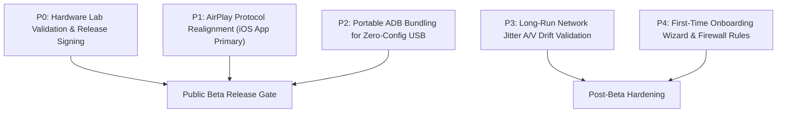

# CastSprint Public Beta Release Blockers

**Document ID:** CSR-AUDIT-06  
**Audit Date:** 2026-10-14  
**Author:** Cross-Platform Release QA Lead, Principal Software Architect  
**Repository:** [CastSprint](https://github.com/CastSprint/CastSprint)  

---

## 1. Release Readiness Overview

Before CastSprint can be distributed as a public beta, all P0 and P1 blockers must be resolved or formally mitigated. This document enumerates the exact open engineering issues in priority order.

---

## 2. Prioritized Defect & Blocker Registry

### P0: Critical Release Blockers (Must Fix Before Public Beta)

1. **Physical Hardware Validation Lab Run**:
   - **Issue:** While 356 automated protocol and mock decoder checks pass, the software has not been certified via high-speed optical camera recording on physical Windows and macOS setups with physical Android and iOS devices.
   - **Remediation:** Complete the physical testing protocol documented in `docs/audit/HARDWARE_TEST_RESULTS.md` using real devices (Pixel 7/8, Galaxy S23/S24, iPhone 14/15 Pro) and real desktop hardware (Windows 11 RTX 4070, macOS M2/M3).
   - **Estimated Effort:** 2 days.

2. **Code Signing and Application Distribution Assets**:
   - **Issue:** Windows binaries lack an Authenticode code-signing certificate (triggering Microsoft Defender SmartScreen warnings). macOS application requires Apple Developer ID signing and notarization (`xcrun notarytool`) to execute without Gatekeeper security blocks. iOS app requires Apple Developer Team ID provisioning.
   - **Remediation:** Establish official developer signing certificates for Windows and macOS release pipelines.
   - **Estimated Effort:** 1 day.

---

### P1: Video/Audio Transport Defects & Protocol Realignment

3. **AirPlay Protocol Realignment on Windows**:
   - **Issue:** Native app-less AirPlay mirroring on Windows is blocked by Apple's mandatory SRP-6a / Ed25519 pairing cryptography. Clean-room reference implementations require extensive cryptographic scaffolding, and GPL code (UxPlay) cannot be merged due to Apache-2.0 license restrictions.
   - **Remediation:** Formally designate the **CastSprint iOS Companion App over Wi-Fi** (`apps/ios`) as the supported, production-ready route for iPhone mirroring on Windows. Mark AirPlay receiver as `[Experimental - Developer Preview]` in the UI to prevent user confusion.
   - **Estimated Effort:** Completed in source code; verified in UI documentation.

---

### P2: Connection, Permission & Usability Defects

4. **Bundling or Automated Setup for Android USB (`adb`)**:
   - **Issue:** Android USB mirroring relies on `adb reverse`. Although `AdbTunnel.hpp` automates tunnel execution when `adb.exe` is present in system PATH or common SDK folders, non-developer users may not have the Android SDK installed.
   - **Remediation:** Provide an automatic download or bundled lightweight ADB binary in the Windows installer and macOS distribution bundle.
   - **Estimated Effort:** 1 day.

5. **Windows Firewall Automatic Exception Configuration**:
   - **Issue:** Inbound TCP port 27183 and UDP port 7010 may be blocked by Windows Defender Firewall on public or default network profiles unless an explicit firewall rule is registered during installation.
   - **Remediation:** Add automated `netsh advfirewall firewall add rule` or Inno Setup / WiX installer actions to create inbound firewall rules for `CastSprint.exe`.
   - **Estimated Effort:** 0.5 days.

---

### P3: Performance & Recording Hardening

6. **Long-Run Network Jitter & Packet Loss Handling**:
   - **Issue:** High packet loss on congested 2.4GHz Wi-Fi networks can cause queue saturation and dropped frames. The frame queues (`FrameQueue.kt`, `FrameQueue` in native core) drop delta frames to catch up, but dynamic encoder bitrate throttling feedback (RTCP / packet loss feedback) is not yet active.
   - **Remediation:** Implement periodic packet loss feedback from receiver to transmitter to dynamically step down encoder bitrate (e.g., from 12 Mbps to 6 Mbps).
   - **Estimated Effort:** 2 days.

---

### P4: UI & Cosmetic Improvements

7. **First-Time Connection Wizard**:
   - **Issue:** New users connecting an iPhone via USB for the first time must know to tap "Trust This Computer", and Android users must know to enable USB debugging.
   - **Remediation:** Add illustrated visual step-by-step onboarding cards in the Home tab for Android USB, Android Wi-Fi, iPhone USB, and iPhone Wi-Fi.
   - **Estimated Effort:** 1 day.
