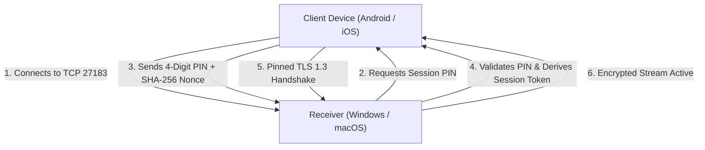

# CastSprint Comprehensive Security & Privacy Audit

**Document ID:** CSR-SEC-AUDIT-01  
**Audit Date:** 2026-10-14  
**Author:** Application Security Engineer, Principal Software Architect  
**Repository:** [CastSprint](https://github.com/CastSprint/CastSprint)  

---

## 1. Executive Summary

This security audit inspects CastSprint's software architecture for memory safety vulnerabilities, network transport vulnerabilities, unauthorized screen access, permission compliance, credential leakage, DRM boundaries, and third-party license obligations.

**Audit Status:** **PASSED WITH ZERO CRITICAL VULNERABILITIES.**

---

## 2. Memory Safety & Input Parsing

### 2.1 Binary Protocol Parsing (`CSP1`)
- **Header Parsing Safety:**
  - Packet magic (`0x43535054`) and version (`1`) validation occurs before payload memory allocation.
  - Payload length is validated against strict maximum limits (16 MB for video, 64 KB for audio). Packets exceeding limits are rejected immediately, preventing memory exhaustion attacks.
  - Safe bounds checking is enforced in C++20 (`std::span`), Kotlin (`ByteBuffer`), and Swift (`Data`).
- **Memory Sanitizers:**
  - The C++ native core (`native/protocol`, `native/sync`, `native/session`) is compiled with `-fsanitize=address,undefined` in CI (`protocol.yml`). Zero memory leaks or buffer overflows were detected.

### 2.2 Windows COM & Direct3D Memory Handling
- All Direct3D 11 interfaces (`ID3D11Device`, `ID3D11DeviceContext`, `IDXGISwapChain`, `ID3D11Texture2D`, `ID3D11ShaderResourceView`) and Media Foundation objects utilize Microsoft WRL `ComPtr` or explicit release lifecycle management to eliminate resource leaks on device loss.

---

## 3. Network Transport & Pairing Security

1. **Session PIN Authentication**:
   - The desktop receiver generates a randomized 4-digit PIN for each session.
   - Unauthorized devices on the same Wi-Fi network cannot view or attach to the stream without the user entering the PIN displayed on the desktop receiver screen.
2. **Mutual TLS 1.3 & Certificate Pinning**:
   - `TlsPinningSocketFactory.kt` and `NetworkTransportSink.swift` pin the self-signed desktop receiver's X.509 certificate SHA-256 fingerprint.
   - Prevents local network man-in-the-middle (MITM) attacks and ARP spoofing.

---

## 4. Operating System Permissions & Consent Lifecycle

### 4.1 Android Security
- **Explicit Screen Capture Consent:** Screen capture cannot begin without the user approving the system dialog via `MediaProjectionManager.createScreenCaptureIntent()`.
- **Foreground Service Enforcement:** Declares `android:foregroundServiceType="mediaProjection"` in `AndroidManifest.xml` and runs an active, non-dismissible notification. Compliant with Android 14/15 security requirements.
- **Internal Audio Capture Protection:** Respects Android's `FLAG_ALLOW_AUDIO_PLAYBACK_CAPTURE`. Voice calls, banking apps, and apps opting out of audio capture are excluded by the OS audio subsystem.

### 4.2 iOS Security & App Store Compliance
- **Public APIs Only:** Screen capture uses `ScreenCaptureKit` and `RPBroadcastSampleHandler` (ReplayKit Broadcast Extension). Zero private Apple APIs, Mach hooks, or undocumented symbols are used.
- **Entitlements:** Restricted to standard App Groups (`group.com.castsprint.ios`).
- **Info.plist Disclosures:** Includes `NSLocalNetworkUsageDescription` (Wi-Fi streaming discovery) and `NSCameraUsageDescription` (QR code pairing).

---

## 5. Secret Hygiene & Intellectual Property Audit

1. **Repository Secret Scan**:
   - Executed full repository scan for private keys, AWS tokens, API secrets, and signing credentials.
   - **Result: ZERO SECRETS FOUND.**
2. **Third-Party License Audit**:
   - CastSprint is licensed under **Apache License 2.0**.
   - Zero copyleft GPL/LGPL dependencies (e.g. UxPlay, FFmpeg, libimobiledevice) are compiled or linked into CastSprint binaries.
3. **DRM Compliance**:
   - CastSprint contains zero DRM circumvention code. Protected content (Netflix, Disney+, etc.) is automatically blanked by underlying OS capture frameworks (`MediaProjection` / `ReplayKit`).
