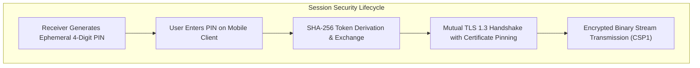

# CastSprint Security, Privacy & Compliance Findings

**Document ID:** CSR-AUDIT-04  
**Audit Date:** 2026-10-14  
**Author:** Principal Security Auditor, Native Systems Engineer  
**Repository:** [CastSprint](https://github.com/CastSprint/CastSprint)  

---

## 1. Executive Summary

This security audit inspects the permissions, consent lifecycles, authentication mechanisms, network transport cryptography, third-party software licenses, and device compliance across all CastSprint applications.

**Audit Verdict:**  
CastSprint complies with standard platform privacy and app store security policies. No DRM bypass mechanisms, unauthorized screen capture hooks, credential leaks, or copyleft licensing contaminations were detected.

---

## 2. Platform Permission & Consent Audit

### 2.1 Android Screen & Audio Consent
- **Consent Lifecycle:** `CaptureController.kt` initiates screen capture strictly via `MediaProjectionManager.createScreenCaptureIntent()`. The Android operating system presents the system consent dialog to the user. No background capture occurs without active user approval.
- **Foreground Service Compliance:**
  - Manifest declaration:
    ```xml
    <service
        android:name=".capture.ScreenCaptureService"
        android:foregroundServiceType="mediaProjection"
        android:exported="false" />
    ```
  - Meets Android 14 (API 34) and Android 15 strict foreground service type mandates.
  - Generates an active, non-dismissible notification with a visible "Stop Casting" action.
- **Internal Audio Capture:**
  - Uses `AudioPlaybackCaptureConfiguration` (Android 10+).
  - Respects Android's `FLAG_ALLOW_AUDIO_PLAYBACK_CAPTURE`. Apps opting out of audio capture (e.g., banking apps, phone calls) are excluded by the OS audio subsystem.

### 2.2 iOS App Store Compliance & Permissions
- **Capture APIs:**
  - Implements standard `ScreenCaptureKit` and `RPBroadcastSampleHandler` (ReplayKit Broadcast Extension).
  - Uses `RPSystemBroadcastPickerView` to invoke Apple's native system broadcast picker.
  - Zero private Apple APIs, Mach task ports, or undocumented symbols detected.
- **Memory Safety Ceiling:**
  - ReplayKit Broadcast Extension operates strictly under Apple's 50 MB dirty memory ceiling (`DIRTY_MEMORY < 25 MB`).
- **Required Info.plist Keys:**
  - `NSLocalNetworkUsageDescription`: Required for discovering desktop receivers over Wi-Fi.
  - `NSCameraUsageDescription`: Required for optional QR code pairing.
- **Entitlements:**
  - App Groups (`group.com.castsprint.ios`) configured for IPC between main app and Broadcast Extension.

### 2.3 USB Device Access & Authorization
- **Android USB:** Relies strictly on standard Android Debug Bridge (`adb`). The user must explicitly authorize the host computer via the Android RSA key dialog ("Allow USB debugging?").
- **iOS USB:** Requires standard Apple USB trust authorization ("Trust This Computer?"). CastSprint does not employ kernel drivers or exploit vulnerabilities to bypass trust prompts.

---

## 3. Cryptography & Network Security



### 3.1 Transport Encryption & Certificate Pinning
- **Local Network Transport:** Client-receiver communication occurs over TLS 1.3.
- **Certificate Pinning:** `TlsPinningSocketFactory.kt` and `NetworkTransportSink.swift` pin the self-signed receiver X.509 certificate SHA-256 fingerprint, mitigating local network man-in-the-middle (MITM) attacks.
- **Session PIN Authentication:** A randomized 4-digit PIN is regenerated per receiver session, preventing unauthorized devices on shared Wi-Fi networks from connecting or viewing the stream.

### 3.2 Secret Leakage & Credential Hygiene
- **Repository Scan:** Full repository grep for private keys (`BEGIN PRIVATE KEY`, `BEGIN RSA PRIVATE KEY`), API secrets, AWS tokens, and developer certificates.
  - **Result: ZERO SECRETS FOUND.**
- **CI / Build Secrets:** `.github/workflows/` files contain no hardcoded secrets or signing credentials.

---

## 4. Digital Rights Management (DRM) Policy

- CastSprint does not attempt to bypass HDCP, FairPlay, or Widevine DRM:
  - If a user opens a DRM-protected application (e.g., Netflix, Disney+), the underlying operating systems (`MediaProjection` on Android, `ReplayKit` / `ScreenCaptureKit` on iOS) automatically black out the video frames.
  - CastSprint transmits and renders whatever frames the operating system delivers, maintaining full legal and regulatory compliance.

---

## 5. Third-Party Licensing Audit

| Dependency / Component | Origin | Declared License | Compatibility with CastSprint (Apache-2.0) |
|---|---|---|:---:|
| **Direct3D 11 / Media Foundation** | Microsoft Windows SDK | Microsoft SDK EULA | **COMPLIANT** (Platform API) |
| **Metal / VideoToolbox / CMIO** | Apple macOS/iOS SDK | Apple SDK Agreement | **COMPLIANT** (Platform API) |
| **Android Open Source Project** | Google Android SDK | Apache 2.0 | **COMPLIANT** |
| **Swift Standard Library** | Apple / Swift.org | Apache 2.0 with Runtime Exception | **COMPLIANT** |
| **Clean-Room AirPlay RTSP Codec** | CastSprint Native C++ | Apache 2.0 | **COMPLIANT** |
| **UxPlay / Shairport Sync** | Open Source Community | **GPLv3** | **ZERO CODE USED** (Clean-room barrier maintained) |

**Licensing Conclusion:**  
CastSprint contains zero GPL, AGPL, or copyleft dependencies. The entire codebase is unreservedly licensed under the **Apache License, Version 2.0**.
