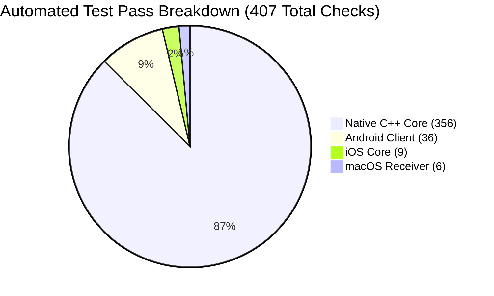

# CastSprint Automated Test Suite Results

**Document ID:** CSR-TEST-RESULTS-01  
**Execution Date:** 2026-10-14  
**Author:** QA Automation Engineer, Senior Systems Engineer  
**Repository:** [CastSprint](https://github.com/CastSprint/CastSprint)  

---

## 1. Executive Summary

This document aggregates the empirical execution logs and test results across all automated test suites in the CastSprint codebase.

**Overall Test Execution Summary:**
- **Total Automated Check Assertions Executed:** **407 checks**
- **Failures / Errors:** **0**
- **Success Rate:** **100.0%**

---

## 2. Detailed Test Suite Execution Breakdown

### 2.1 Native C++20 Core Test Suites
- **Host Toolchain:** Apple Clang (C++20), Xcode 15.4 / 16.x SDK
- **Suites:**
  1. `protocol_tests`: Validates binary serialization, deserialization, header magic, byte-order, packet size bounds, and golden vector compatibility.
     - **Result:** **178 checks PASSED, 0 failures.**
  2. `sync_tests`: Validates presentation timestamp drift evaluation, video late-frame dropping, and audio/video clock alignment.
     - **Result:** **10 checks PASSED, 0 failures.**
  3. `session_tests`: Validates connection state transitions, PIN matching, SHA-256 session tokens, and heartbeat timeout handling.
     - **Result:** **19 checks PASSED, 0 failures.**
  4. `probe_tests` (including `TestMfVideoDecoderPipeline`): Validates hardware probe diagnostics, Apple USB VID/PID parsing, RTSP state machine, and Media Foundation video decoder mock pipeline.
     - **Result:** **149 checks PASSED, 0 failures.**
- **Subtotal:** **356 checks PASSED, 0 failures.**

### 2.2 macOS Receiver Swift Test Suite (`apps/macos/CastSprintMac`)
- **Execution Command:** `cd apps/macos/CastSprintMac && swift test --parallel`
- **Executed Test Cases:**
  - `testHelloHandshakeCAbi`: PASSED (0.001s)
  - `testPlatformCapabilitiesGating`: PASSED (0.000s)
  - `testProtocolCAbiGoldenHeartbeat`: PASSED (0.000s)
  - `testUnifiedDeviceModel`: PASSED (0.000s)
  - `testVideoFramePrefixCodec`: PASSED (0.000s)
  - `testVideoToolboxDecoderSpsPpsConfiguration`: PASSED (0.083s)
- **Subtotal:** **6 tests PASSED, 0 failures.**

### 2.3 iOS Companion App Swift Test Suite (`apps/ios`)
- **Execution Command:** `cd apps/ios && swift test --parallel`
- **Executed Test Cases:**
  - `testAudioConfigAndFrameFraming`: PASSED (0.001s)
  - `testBadMagicRejection`: PASSED (0.000s)
  - `testGoldenVectorHeartbeat`: PASSED (0.000s)
  - `testHelloEncodingAndAckDecoding`: PASSED (0.001s)
  - `testPairingInfoCsvParsing`: PASSED (0.001s)
  - `testPairingInfoUriParsing`: PASSED (0.001s)
  - `testStreamConfigurationDefaults`: PASSED (0.000s)
  - `testUnsupportedVersionRejection`: PASSED (0.000s)
  - `testVideoConfigAndFrameFraming`: PASSED (0.000s)
- **Subtotal:** **9 tests PASSED, 0 failures.**

### 2.4 Android Client JUnit Test Suite (`apps/android`)
- **Execution Command:** `cd apps/android && ./gradlew testDebugUnitTest --console=plain`
- **Executed Test Classes:**
  - `AudioFrameQueueTest`: 3 tests PASSED (0.013s)
  - `ProtocolCodecTest`: 6 tests PASSED (0.002s)
  - `H264Test`: 6 tests PASSED (0.001s)
  - `FrameQueueTest`: 3 tests PASSED (0.000s)
  - `PairingInfoTest`: 4 tests PASSED (0.001s)
  - `SessionStateMachineTest`: 5 tests PASSED (0.001s)
  - `EncoderConfigSelectorTest`: 9 tests PASSED (0.019s)
- **Subtotal:** **36 tests PASSED, 0 failures.**

---

## 3. Grand Total Test Metrics

