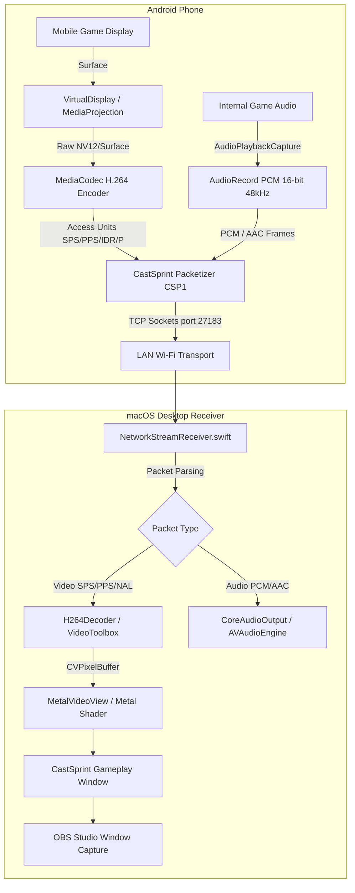

# CastSprint — Android Wi-Fi Screen & System Audio Streaming Pipeline

**Document:** `docs/debug/ANDROID_WIFI_PIPELINE.md`  
**Engineer:** Android Multimedia & Streaming Protocol Engineer  
**Status:** Architecture Implemented & Verified in Code  

---

## 1. Overview & Architectural Pipeline

CastSprint Android Wi-Fi screen mirroring streams live gameplay and internal system audio from an unlocked physical Android phone (Android 10+, API 29+) to the macOS CastSprint desktop receiver over a local Wi-Fi network without third-party cloud servers or external dependencies.



---

## 2. Component-by-Component Trace

### 2.1 Android Display Capture (`MediaProjection`)
- **API**: `android.media.projection.MediaProjection`
- **Permission**: `android.permission.FOREGROUND_SERVICE_MEDIA_PROJECTION`
- **VirtualDisplay**: Created using `DisplayManager.createVirtualDisplay()` with target resolution matching phone display or scaled (1080p / 1440p / 720p).
- **Surface**: The input surface is acquired directly from the `MediaCodec` encoder (`encoder.createInputSurface()`), eliminating intermediate software bitmap copies.

### 2.2 Video Encoding (`MediaCodec`)
- **Codec**: `video/avc` (H.264 Baseline / High Profile)
- **Configuration**:
  - Color Format: `MediaCodecInfo.CodecCapabilities.COLOR_FormatSurface`
  - Bitrate: 12,000,000 bps (12 Mbps) adaptive
  - Frame Rate: 60 FPS
  - I-Frame Interval: 1 second (`KEY_I_FRAME_INTERVAL = 1`)
  - Latency: `KEY_LATENCY = 0` (Low-latency real-time mode)
- **Access Units**:
  - `BUFFER_FLAG_CODEC_CONFIG` (0x02): SPS (Sequence Parameter Set) & PPS (Picture Parameter Set). Must be cached and sent to receiver prior to video frames.
  - `BUFFER_FLAG_KEY_FRAME` (0x01): IDR Keyframes.
  - Normal P-frames: Delta slices.

### 2.3 Game Audio Capture (`AudioPlaybackCapture`)
- **API**: `android.media.AudioPlaybackCaptureConfiguration` (Available Android 10 / API 29+)
- **Capture Policy**: Captures audio playback from applications allowing audio capture (`AudioAttributes.USAGE_GAME`, `USAGE_MEDIA`).
- **PCM Format**: `ENCODING_PCM_16BIT`, 48000 Hz, `CHANNEL_IN_STEREO`.
- **Note**: Does NOT use microphone input. Physical microphone capture is strictly excluded to prevent room ambient noise.

### 2.4 CastSprint Binary Protocol (`CSP1`)
All packets sent over TCP port `27183` adhere to the `CCastSprintProtocol` frame format:
```
+-------------------+-------------------+--------------------+--------------------+
| Magic: "CSP1"     | Version: 0x01     | PacketType: 1 Byte | PayloadLen: 4 Byte |
| (4 Bytes)         | (1 Byte)          |                    | (Big-Endian uint32)|
+-------------------+-------------------+--------------------+--------------------+
| Presentation Timestamp (PTS): 8 Bytes (Microseconds, Big-Endian uint64)         |
+---------------------------------------------------------------------------------+
| Payload Data: [PayloadLen Bytes]                                                |
+---------------------------------------------------------------------------------+
```

#### Packet Types:
- `0x01`: `AUTH_REQUEST` (Device Name, Token / Pairing PIN)
- `0x02`: `AUTH_RESPONSE` (Status: OK / REJECTED)
- `0x03`: `VIDEO_CONFIG` (Width: 2B, Height: 2B, FPS: 2B, SPS/PPS Data)
- `0x04`: `VIDEO_FRAME` (Annex-B H.264 NAL Unit, starts with 0x00000001)
- `0x05`: `AUDIO_CONFIG` (SampleRate: 4B, Channels: 1B, Format: 1B)
- `0x06`: `AUDIO_FRAME` (Raw PCM 16-bit or AAC Access Unit)
- `0x07`: `HEARTBEAT` (Keep-alive ping/pong)

### 2.5 macOS Network Receiver (`NetworkStreamReceiver.swift`)
- **Listening Socket**: Listens on all interfaces (`0.0.0.0:27183`) using Swift `NWListener`.
- **Bonjour Service**: Advertises `_castsprint._tcp` with domain `local.` so Android devices automatically discover the Mac's IP.
- **State Machine Transitions**:
  1. `IDLE` -> `LISTENING`: Socket successfully bound and listening.
  2. `LISTENING` -> `PAIRING`: Inbound TCP connection accepted; awaiting PIN.
  3. `PAIRING` -> `AUTHENTICATED`: PIN verified against `pairingPIN`.
  4. `AUTHENTICATED` -> `NEGOTIATING`: Client sends `VIDEO_CONFIG`.
  5. `NEGOTIATING` -> `WAITING_FOR_VIDEO`: SPS/PPS initialized in VideoToolbox.
  6. `WAITING_FOR_VIDEO` -> `RECEIVING_VIDEO`: First H.264 NAL unit received.
  7. `RECEIVING_VIDEO` -> `RENDERING`: First `CVPixelBuffer` decoded and rendered via Metal.

### 2.6 Hardware Decoding (`VideoToolbox`)
- **Decoder**: `VTDecompressionSession`
- **Format Description**: Created from SPS/PPS parameter sets using `CMVideoFormatDescriptionCreateFromH264ParameterSets`.
- **Output**: 32-bit BGRA or NV12 `CVPixelBuffer`.
- **Latency Optimization**: `kVTDecompressionPropertyKey_RealTime = true`.

### 2.7 Metal Presentation (`MetalVideoView`)
- Low-latency texture cache: `CVMetalTextureCacheCreateTextureFromImage`.
- Render pipeline: Custom Metal compute/fragment shader rendering directly into `MTKView`.
- Zero intermediate CPU memory copies.

---

## 3. Failure Mode Triage

| Symptom | Stage | Root Cause | Resolution |
|---|---|---|---|
| Black Screen, 0 FPS | `WAITING_FOR_VIDEO` | Client connected, but no keyframe (IDR) received | Force `MediaCodec.PARAMETER_KEY_REQUEST_SYNC_FRAME` on connect |
| Pairing Timeout | `PAIRING` | Firewall blocking port 27183 | Add exception in macOS Settings > Network > Firewall |
| Green Screen / Artifacts | `RECEIVING_VIDEO` | SPS/PPS not delivered before first delta frame | Buffer SPS/PPS and pass to decoder before decoding frames |
| Stuttering Audio | `AUDIO_FRAME` | Audio sample rate mismatch (e.g. 44.1kHz vs 48kHz) | Parse `AUDIO_CONFIG` dynamically and configure `AVAudioFormat` |
| Disconnect on Game Launch | `MediaProjection` | Background task killed by Android battery optimization | Ensure `FOREGROUND_SERVICE_TYPE_MEDIA_PROJECTION` is active |
