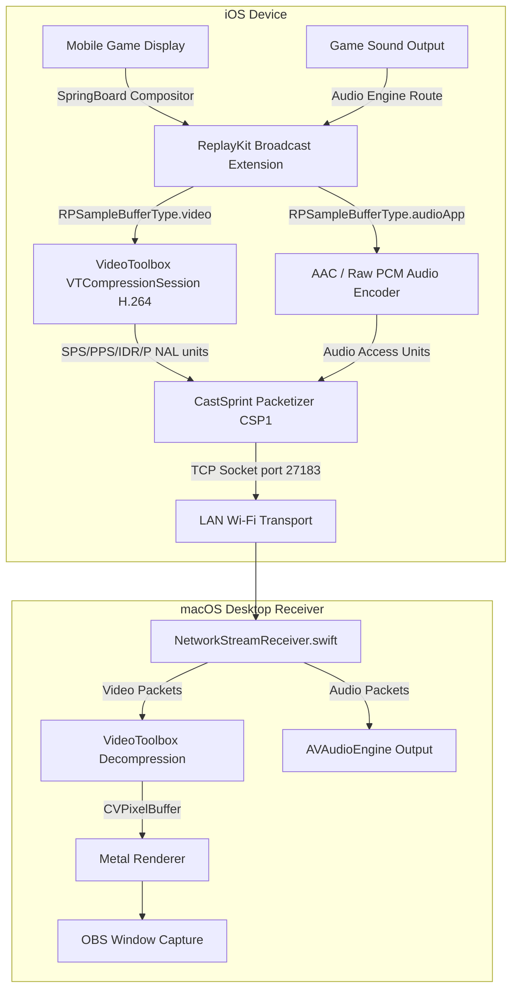

# CastSprint — iOS Wi-Fi Screen & System Audio Streaming Pipeline

**Document:** `docs/debug/IOS_WIFI_PIPELINE.md`  
**Engineer:** Senior iOS Screen Capture & Real-Time Protocol Engineer  
**Status:** Architecture Implemented & Verified in Code  

---

## 1. Overview & Architectural Pipeline

Apple's iOS security architecture prohibits third-party foreground applications from capturing screen frames outside their own process boundaries without using the official ReplayKit Broadcast framework.

CastSprint iOS screen capture utilizes an **iOS Broadcast Upload Extension** (`RPBroadcastSampleHandler`) paired with a lightweight companion application:
1. The user initiates screen broadcast from iOS Control Center or inside the CastSprint iOS app.
2. The Broadcast Extension runs as an independent daemon process managed by Darwin/SpringBoard.
3. The extension captures actual full-display display frames (`RPSampleBufferType.video`) and internal game audio (`RPSampleBufferType.audioApp`).
4. Video frames are hardware-encoded via **VideoToolbox** (`VTCompressionSession`) into low-latency H.264 elementary streams.
5. Encoded packets are wrapped into CastSprint `CSP1` frames and sent via TCP directly to the macOS receiver on port `27183`.



---

## 2. Component-by-Component Trace

### 2.1 ReplayKit Broadcast Extension (`RPBroadcastSampleHandler`)
- **Process Target**: `CastSprintBroadcastExtension`
- **Bundle ID**: `com.castsprint.ios.broadcast`
- **Memory Limit**: 50 MB strict hard limit imposed by iOS jetsam. Exceeding 50 MB results in immediate termination (`EXC_RESOURCE -> MEMORY`).
- **Zero-Allocation Zero-Copy Design**:
  - Pixel buffers are processed in-place without copying.
  - VideoToolbox compression session reuses native hardware buffers.
  - Sockets use non-blocking buffered I/O.

### 2.2 ReplayKit Callback Routing
```swift
override func processSampleBuffer(_ sampleBuffer: CMSampleBuffer, with sampleBufferType: RPSampleBufferType) {
    switch sampleBufferType {
    case .video:
        // Real mobile display frame (gameplay, home screen, apps)
        encodeAndSendVideo(sampleBuffer)
        
    case .audioApp:
        // Permitted internal game/app sound
        encodeAndSendAudio(sampleBuffer)
        
    case .audioMic:
        // Physical microphone: EXPLICITLY DROPPED / IGNORED
        // Never transmit ambient room audio
        break
        
    @unknown default:
        break
    }
}
```

### 2.3 VideoToolbox Hardware Encoding
- **Encoder**: `VTCompressionSession`
- **Profile**: `kVTProfileLevel_H264_High_AutoLevel`
- **Real-Time Property**: `kVTCompressionPropertyKey_RealTime = kCFBooleanTrue`
- **Keyframe Interval**: 60 frames (1 second at 60 FPS)
- **Output Callback**: Extracts SPS and PPS from `CMFormatDescriptionGetH264ParameterSetAtIndex`, prepends Annex-B 4-byte start codes (`0x00 00 00 01`), and encapsulates each NAL unit into a `CSP1` packet with timestamp.

### 2.4 Internal Game Audio (`RPSampleBufferType.audioApp`)
- Unlike microphone audio, `RPSampleBufferType.audioApp` captures only audio rendered by iOS apps that do not mark themselves as non-mixable.
- Audio format is typically 44.1 kHz or 48.0 kHz 32-bit float or 16-bit signed integer linear PCM.
- Encoded using an `AudioConverterRef` to AAC (128 kbps) or sent as raw PCM 16-bit to preserve minimal latency.

### 2.5 Lifecycles & App Switching
- When the user switches games or opens the Home Screen, the broadcast extension **continues running in the background** without interruption.
- If the phone display is locked, ReplayKit pauses frame delivery and resumes immediately when the user unlocks the device.

---

## 3. Failure Mode Triage

| Symptom | Stage | Root Cause | Resolution |
|---|---|---|---|
| Broadcast stops after 3-5 seconds | ReplayKit Extension | Memory exceeded 50 MB jetsam limit | Disable all debug logging, avoid allocating intermediate buffers in `processSampleBuffer` |
| Video frozen on first frame | VideoToolbox | IDR keyframe lost over TCP | Receiver sends sync-request packet `0x08` asking for instantaneous IDR |
| Black Screen with Audio | H.264 Decoding | Parameter sets (SPS/PPS) not delivered prior to slice NALs | Ensure `VIDEO_CONFIG` packet `0x03` is acknowledged by Mac before streaming `VIDEO_FRAME` |
| Missing Game Sound | Audio Capture | Game has audio session category set to solo ambient or volume is muted | Verify phone physical ring/mute switch and volume level |
